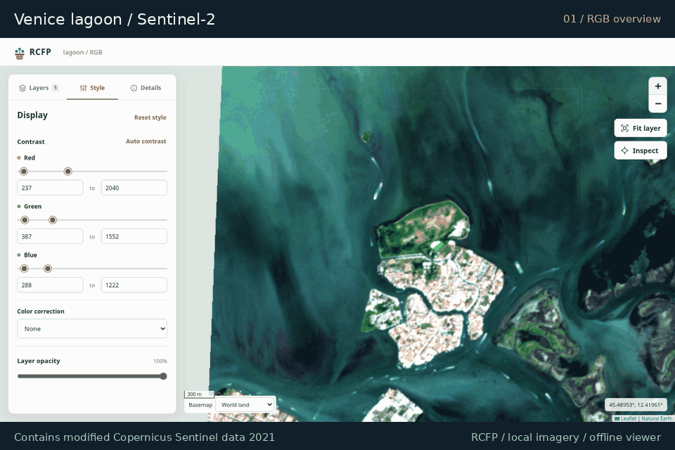

# Rust-colored flower pot

**Raster maps, served by Rust.**

RCFP turns GeoTIFFs and catalogs into interactive maps. Keep supported
Terracotta workflows, or use native layers, STAC, mosaics, and Python models.
One Rust core powers the tile server, CLI, Python API, WSGI, and Lambda adapters.
Matching wheels bundle GDAL/PROJ and the executable.

[Get started](#from-zero-to-map) | [Coming from Terracotta?](#keep-your-terracotta-workflow) |
[Feature demos](docs/tutorials/native-demos.md) | [Documentation](docs/README.md) |
[Live Lambda API](https://atyp7fgt6ar4i4eddkp2jndixi0abpia.lambda-url.eu-north-1.on.aws/apidoc)



<sub>Real Sentinel-2 imagery, rendered by RCFP in the offline viewer. Edited
playback, not a latency measurement. Contains modified Copernicus Sentinel data 2021. [Still image](docs/static/readme/navigation.png) |
[Reproduce the demos](docs/tools/readme-media.md)</sub>

## From zero to map

Install a [matching wheel](docs/how-to/install.md), or build from this checkout
with CPython 3.12–3.14, a C/C++ compiler, and Python headers:

```sh
python3.12 -m venv .venv
. .venv/bin/activate
python -m pip install .
```

The source build downloads the pinned Rust toolchain and native runtime on first
use. To install a prebuilt wheel, follow the [installation guide](docs/how-to/install.md).

Create a ready-to-serve map from the bundled real imagery:

```sh
rcfp sample -o sample
rcfp serve -d sample/map.sqlite
```

In a second terminal, with the same environment active:

```sh
rcfp connect localhost:5000
```

Select **lagoon / red**, then try **Rendering → RGB** or an expression.
The viewer works offline after installation, with no map token or data download.
The server also exposes [`/keys`](http://127.0.0.1:5000/keys),
[`/datasets`](http://127.0.0.1:5000/datasets), and
[`/apidoc`](http://127.0.0.1:5000/apidoc).
[First-map tutorial](docs/tutorials/first-map.md) |
[Inspect your own imagery](docs/how-to/diagnostics.md)

To explore the **live AWS Lambda demo** with the same viewer:

```sh
rcfp connect https://atyp7fgt6ar4i4eddkp2jndixi0abpia.lambda-url.eu-north-1.on.aws/
```

## Keep your Terracotta workflow

RCFP's **`terracotta` profile** is compatible with the latest Terracotta release,
[0.10.1](https://pypi.org/project/terracotta/0.10.1/), for supported public
HTTP, Python, WSGI, and CLI workflows. Supported current catalogs and raster files
need no conversion or reingestion.

Try it against a catalog copy on a separate port:

```sh
rcfp --compat-profile terracotta serve -d catalog-copy.sqlite --port 5001
```

| Keep                                                            | Change                                                      |
| --------------------------------------------------------------- | ----------------------------------------------------------- |
| Supported GeoTIFFs, raster paths, and format-0.10 catalogs      | Install RCFP in a separate environment                      |
| Public discovery, metadata, singleband, RGB, and compute routes | Point your HTTP client at the RCFP service                  |
| Documented Python drivers, settings, masked arrays, and futures | Replace `terracotta` import/submodule prefixes with `rcfp`  |
| Supported CLI commands and flags, applicable `TC_*` settings    | Use the `rcfp` command and select the compatibility profile |

Select the profile **before Python imports** with
`RCFP_COMPAT_PROFILE=terracotta`. No `terracotta` import or executable alias
is installed. Private Flask/Click hooks, SQLAlchemy connections, and internal
Rasterio helpers are outside the compatibility contract. Older catalog schemas
need an explicit upgrade.

[Migration and rollback](docs/how-to/upgrade-terracotta.md) |
[Compatibility trial](docs/compatibility.md) |
[Support matrix](docs/reference/support.md)

## Go beyond Terracotta

The default **native profile** adds ways to publish, compute, embed, and operate
raster maps. Each capability has an [end-to-end demo](docs/tutorials/native-demos.md)
using the bundled samples:

| Capability                                                           | What you can do                                                                                                                                                                                       |
| -------------------------------------------------------------------- | ----------------------------------------------------------------------------------------------------------------------------------------------------------------------------------------------------- |
| **[Logical bands and stored expressions](docs/reference/layers.md)** | Bind named bands in packed or separate TIFFs, apply scale/offset, and persist derived datasets with display defaults. [Run the demo](docs/tutorials/native-demos.md#logical-bands-and-expressions).   |
| **[STAC sources](docs/how-to/stac.md)**                              | Serve static catalogs or bounded API search selections, or ingest a resolved snapshot into a keyed catalog. [Run the demo](docs/tutorials/native-demos.md#stac-sources).                              |
| **[Indexed virtual mosaics](docs/how-to/mosaics.md)**                | Select overlapping observations by footprint and attributes, bound source/read costs, and inspect per-pixel contributors. [Run the demo](docs/tutorials/native-demos.md#indexed-virtual-mosaics).     |
| **[Python compute layers](docs/how-to/python-compute.md)**           | Receive aligned NumPy arrays and masks, run your model, and return scalar values for RCFP to render. [Run the demo](docs/tutorials/native-demos.md#python-compute-layers).                            |
| **[Browser SDK](docs/reference/javascript.md)**                      | Embed maps with typed JavaScript APIs and Leaflet, MapLibre, or OpenLayers integrations; share a view and inspect display pixels. [Run the demo](docs/tutorials/native-demos.md#browser-sdk).         |
| **[Rendered publication](docs/how-to/rendered-caching.md)**          | Revalidate with ETags, pin immutable image revisions, coalesce requests, and opt into bounded image caching. [Run the demo](docs/tutorials/native-demos.md#rendered-publication).                     |
| **[Native operations](docs/how-to/resources.md)**                    | Serve without a Python host, set worker/queue/cache budgets, and inspect [metrics](docs/reference/monitoring.md) and configuration. [Run the demo](docs/tutorials/native-demos.md#native-operations). |

For example, make NDVI a discoverable dataset using the quickstart samples:

```python
import rcfp

store = rcfp.DataStore("vegetation.sqlite")
store.create(["scene", "band"], format="native")
for band in ("red", "nir"):
    store.insert(["lagoon", band], f"sample/data/{band}.tif", values="scaled")
store.define(
    ["lagoon", "ndvi"], "(nir-red)/(nir+red)",
    {"nir": ["lagoon", "nir"], "red": ["lagoon", "red"]},
    stretch=[-1, 1], colormap="viridis",
)
```

Run `rcfp serve -d vegetation.sqlite`. The derived layer appears in `/datasets`
and renders through `/singleband/lagoon/ndvi/preview.png` and the usual XYZ routes.
Native keyed catalogs currently write to local SQLite. The
[native migration guide](docs/native-migration.md) explains API and rendering
differences from the compatibility profile.

## Faster map navigation

In a four-core Linux benchmark, native RCFP completed first viewports
**1.7–6.0× faster** and pans **5.2–18.8× faster** than the tested Terracotta and
TiTiler configurations.

| Storage / layer            | First view vs Terracotta | First view vs TiTiler | Pan vs Terracotta | Pan vs TiTiler |
| -------------------------- | -----------------------: | --------------------: | ----------------: | -------------: |
| Local / singleband         |                     5.2× |                  4.7× |             18.8× |          13.3× |
| Local / RGB                |                     5.6× |                  6.0× |              8.7× |           7.3× |
| Remote ranges / singleband |                     2.6× |                  1.7× |              9.2× |           8.5× |
| Remote ranges / RGB        |                     3.3× |                  2.2× |             10.0× |           5.2× |

These measurements cover local files and a controlled remote range origin, with
finished-image caching and prefetch disabled. Ratios describe the measured native
build and workloads; browser paint and actual S3 are outside this comparison.
[Absolute timings, fidelity, conditions, and reproduction](docs/explanation/performance.md#terracotta-and-titiler-navigation-comparison).

A separate Lambda/private-S3 comparison used a real Leaflet map. First views were
about **1.9× faster**, pans **1.17–1.43× faster**, and zooms **1.39–2.12× faster**
than Terracotta for the tested full-scene Sentinel-2 workload.
[Deployed comparison and limits](docs/explanation/performance.md#deployed-lambda-comparison).

## Find your next step

[Build a catalog](docs/tutorials/catalog.md) |
[Configure RCFP](docs/how-to/configure.md) |
[Deploy with WSGI](docs/how-to/wsgi.md),
[containers](docs/how-to/container.md), or
[Lambda](docs/how-to/lambda.md) |
[Contribute](docs/contributing.md) |
[Run the tests](tests/README.md)

RCFP is [MIT licensed](LICENSE) and builds on
[Terracotta](https://github.com/DHI/terracotta)'s raster-serving workflow.
See [third-party notices](THIRD_PARTY_NOTICES.md) for bundled software and data.
Contributor constraints and verification practices are in the
[maintenance guide](docs/maintaining.md).
